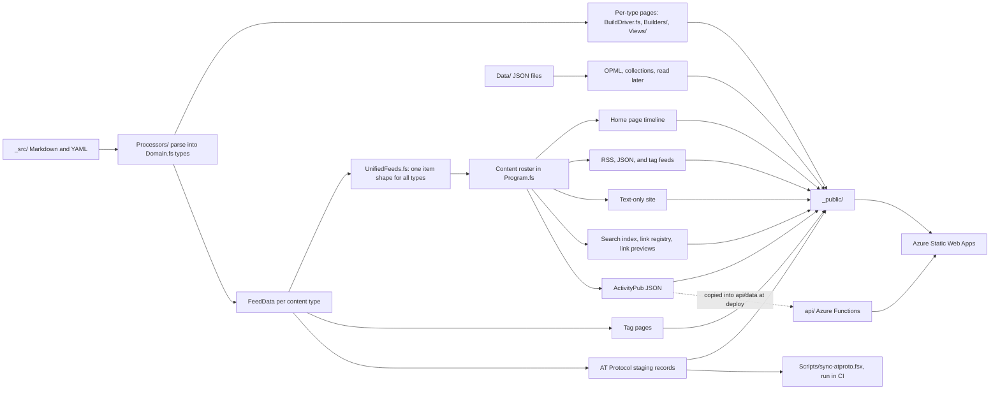

# lqdev.me

This is the source for [lqdev.me](https://www.lqdev.me), my personal website, and the static site
generator I wrote in F# to build it. The site is my digital home and my identity on the web: I
publish here first, and from here the same posts reach people through RSS, the Fediverse, and
Bluesky, which the IndieWeb calls [POSSE](https://indieweb.org/POSSE). I'm a little extreme about
owning the whole stack, so the generator, the Webmention service, and the ActivityPub support are
all my own code.

This README is as much for me as it is for anyone looking at the repo for the first time. It says
what the site is, how it works, and how to run it, and links to the page that covers each topic.

## Principles

- Start as a website, add social features as components.
- One identity, many post types.
- Own the whole stack.
- Keep it light, with a text-only site that aims for pages under 50 KB.
- A person can maintain it without AI.
- Don't let perfect be the enemy of good.

More in [docs/principles.md](docs/principles.md).

## How it works



Content is Markdown with YAML frontmatter in `_src/`. Each of the 14 content types has a processor
in `Processors/` that parses its files into the types in `Domain.fs` and renders that type's pages.
`UnifiedFeeds.fs` then turns every type into one shared item shape, and the home page, the RSS and
JSON feeds, the text-only site, the search index, and the ActivityPub JSON are all built from it,
alongside the AT Protocol records that a CI script posts to Bluesky. Everything is written to
`_public/` and served by Azure Static Web Apps, and 10 Azure Functions in `api/` handle the parts of
ActivityPub that need a server, such as the inbox and WebFinger.

More in [docs/architecture.md](docs/architecture.md). The decisions behind it are in
[docs/adr/](docs/adr/README.md).

## Run it locally

You need the .NET SDK version in `global.json` (11.0.100) and Node.js for the preview, or open the
repo in the dev container.

```powershell
git clone https://github.com/lqdev/luisquintanilla.me.git
cd luisquintanilla.me
$localLock = Join-Path $env:TEMP 'lqdev-net11-local.lock.json'
Copy-Item packages.lock.json $localLock
dotnet restore --force-evaluate -p:NuGetLockFilePath=$localLock
$env:GITHUB_TOKEN = ''
$env:ACTIVITYPUB_STORAGE_CONNECTION = ''
dotnet build --no-restore -p:NuGetLockFilePath=$localLock
dotnet run --no-build -- --strict
npx serve _public
```

The restore uses a copy of the lock file because a local NuGet cache can hold a package whose hash
doesn't match the committed one, and the committed file shouldn't change. On 2026-11-23 the build
took 10 seconds with one expected warning (FS1104), generating took 95 seconds and wrote 14,645
files to `_public/`, and the preview served it at http://localhost:3000. If restore fails, see
[docs/getting-started.md](docs/getting-started.md).

## What's in the repo

| Path | What it is |
| --- | --- |
| `_src/` | The content: Markdown with YAML frontmatter, plus the site's CSS and JavaScript |
| `Program.fs` | The entry point. Runs every build step in order and sets the exit code |
| `Domain.fs`, `ContentTypes.fs` | The types for every content type, and the one place their names live |
| `Processors/` | One processor per content type: parse, render, and build the RSS item |
| `Builders/`, `Views/` | Page builders, and the Giraffe ViewEngine views that produce the HTML |
| `Services/` | Shared helpers: tags, Markdown, OPML, Webmentions, link previews, follower sync |
| `api/` | Azure Functions for ActivityPub: the inbox, outbox, actor, followers, and WebFinger |
| `Scripts/`, `test-scripts/` | Maintenance scripts, and the F# regression tests CI runs |
| `.github/` | Workflows that build, deploy, and publish, and the issue templates I post from |
| `docs/` | The documentation |

## Publishing

The main way I post notes, responses, bookmarks, and media is to open a GitHub issue from one of the
13 templates in `.github/ISSUE_TEMPLATE/`. A workflow turns the issue into a Markdown file in `_src/`
and opens a pull request with it. See
[docs/guides/publishing/github-issues.md](docs/guides/publishing/github-issues.md).

## Documentation

Start at [docs/README.md](docs/README.md). It's organized by what you want to do: understand the
site, run it, publish something, set up content, read about a feature, look something up, maintain
it, or change the docs.

## Working with AI agents

A lot of this repo is written with AI coding agents. Of the last 500 commits on 2026-11-23, 148 of
the 200 that weren't made by the publishing bot credit Copilot. The instructions those agents follow
are in [AGENTS.md](AGENTS.md).

## Links

- Site: <https://www.lqdev.me>
- What the site federates: [FEDERATION.md](FEDERATION.md)
- History: [changelog.md](changelog.md)
