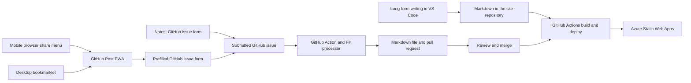

Most of my website is static. The content is Markdown, and I wrote a static site generator in F# to turn those files into the pages you see here. There are a few dynamic pieces around AT Protocol and ActivityPub, including related Azure Functions, but the writing itself is still just files in a Git repository.

That setup works well for long-form posts. I write them on my computer in [VS Code](https://code.visualstudio.com/), then commit the Markdown to GitHub. But my site is more than long-form articles. I also publish notes, photos and videos, replies, likes, reshares, bookmarks, and RSVPs—the kinds of small interactions people often share on social media.

For those, I wanted to get closer to the social-media experience: see something, tap once, and save or respond to it on my own site. The content model is still Markdown, though, so the question became how to make that feel quick without building a whole publishing platform around it.

## Making Markdown less tedious

My first improvement was using [VS Code snippets](https://code.visualstudio.com/docs/editor/userdefinedsnippets). A snippet is a reusable bit of text that expands when you type its shortcut. I use them for frontmatter and recurring Markdown blocks, so I spend less time typing boilerplate and more time on the post itself.

For example, the article snippet in my [metadata snippets file](https://github.com/lqdev/luisquintanilla.me/blob/main/.vscode/metadata.code-snippets) fills in the fields my site expects:

```json
"Article Post metadata": {
    "scope": "markdown",
    "prefix": "article",
    "body": [
        "---",
        "post_type: \"article\" ",
        "title: \"$1\"",
        "description: \"$2\"",
        "published_date: \"$CURRENT_YEAR-$CURRENT_MONTH-$CURRENT_DATE $CURRENT_HOUR:$CURRENT_MINUTE -05:00\"",
        "tags: [\"$3\"]",
        "---",
        "",
        "$0"
    ],
    "description": "Blog post article metadata"
}
```

I wrote more about [automating frontmatter with VS Code snippets](/posts/automate-yaml-front-matter-vs-code-snippets/). This helped with the keystrokes, but the workflow still assumed I was sitting at a computer with VS Code open.

I also have a separate [content snippets file](https://github.com/lqdev/luisquintanilla.me/blob/main/.vscode/content.code-snippets) for things like YouTube links, images, and media blocks. For example, typing `yt` expands into a linked video thumbnail, while `media-image` scaffolds the site's structured media block.

## A tiny computer in my pocket

That changed when I had a Surface Duo. With its two screens, I could open my site's repository in GitHub's browser-based editor, [github.dev](https://www.lqdev.me/notes/surface-duo-blogging-github-dev), and use one screen for the editor and the other for the keyboard. It felt like a little pocket computer. My snippets were there, too, which made it possible to write and publish a short post without waiting until I was back at my desk.

It worked, but it wasn't exactly comfortable. VS Code on a small screen is still VS Code on a small screen, and doing the Git and pull-request steps on a phone added friction. Then the Surface Duo stopped receiving security updates. Around that time I was also carrying a dumbphone, so publishing from my laptop was good enough. When I eventually had a single-screen smartphone again, I could have gone back to the browser editor, but the experience wasn't appealing enough to bother.

I'm still holding out for a true [mobile computer](https://lqdev.me/posts/i-want-mobile-computer/), but in the meantime I wanted a better publishing interface than a tiny code editor.

## A Discord bot was the first bridge

For a while, my mobile workflow was to send myself links in [Element](https://element.io/) and deal with them later at my desk. It was an easy way to capture something, but it also meant links could disappear in the stream of messages before I got around to writing about them.

I tried extending that familiar “note to self” flow by building a [Discord publishing bot](https://github.com/lqdev/discord-publish-bot). I could use a Discord slash command, fill in a small form, and have the bot create a branch and pull request with a Markdown post. A pull request (PR) is a proposed change that I can review before merging it into the site.

One important detail: the bot did **not** create a GitHub issue or use an issue template. It called GitHub's APIs directly to create the branch and PR. GitHub Actions still handled the regular site build and deployment after I merged the PR, but the bot itself was the middleware translating my Discord input into repository changes. I wrote more about that version in [Mobile-First Static Site Publishing: Discord Bot Pipeline via Azure and GitHub](/posts/website-mobile-publishing-discord-client/).

I was happy with it, but the bot added another service and infrastructure to maintain. It was also effectively a custom form backed by custom API code. I had deployed it to Azure Container Apps with scale-to-zero to avoid paying for an always-running service, but that came with cold starts. And once I was already sending the data to GitHub, I started wondering why I was building a separate form and API workflow at all.

## GitHub Issues as the authoring interface

The answer had been sitting in front of me: if publishing a post is mostly filling in fields, GitHub Issues can be the form.

GitHub [issue forms](https://docs.github.com/en/communities/using-templates-to-encourage-useful-issues-and-pull-requests/syntax-for-issue-forms) let a repository define structured fields such as text inputs, text areas, dropdowns, and checkboxes. When someone submits the form, GitHub creates an issue with the answers. In my case, the issue is not a bug report; it's a convenient place to enter the information for a new post. I'm not trying to turn GitHub Issues into a general-purpose CMS. I'm using the form as a lightweight authoring interface for content that still lives in Markdown.

I added a [bookmark issue form](https://github.com/lqdev/luisquintanilla.me/blob/main/.github/ISSUE_TEMPLATE/post-bookmark.yml) and a [GitHub Actions workflow](https://github.com/lqdev/luisquintanilla.me/blob/main/.github/workflows/process-content-issue.yml) that listens for issues with the appropriate label. The workflow reads the form answers, passes them to an [F# script](https://github.com/lqdev/luisquintanilla.me/blob/main/Scripts/process-bookmark-issue.fsx), writes a Markdown file in the right content folder, and opens a PR for review. After I review and merge that PR, the [site deployment workflow](https://github.com/lqdev/luisquintanilla.me/blob/main/.github/workflows/publish-azure-static-web-apps.yml) builds the site and publishes it to [Azure Static Web Apps](https://learn.microsoft.com/en-us/azure/static-web-apps/overview). [GitHub Actions](https://docs.github.com/en/actions) is GitHub's hosted automation service; here it handles the content-processing and deployment steps.

That PR is an important part of the design. The issue form makes it easy to start a post, but it doesn't publish straight to `main`. I still get a chance to check the generated Markdown and make edits before it goes live.

Here is an example of a [recent bookmark issue](https://github.com/lqdev/luisquintanilla.me/issues/2883). **Screenshot to add:** a crop of the submitted issue showing the form fields, linked to the issue above.

## From a shared link to a prefilled issue

Once GitHub Issues became the authoring interface, I found another useful feature: GitHub can open a new issue with fields prefilled from URL query parameters. The [GitHub documentation](https://docs.github.com/en/issues/tracking-your-work-with-issues/using-issues/creating-an-issue#creating-an-issue-from-a-url-query) explains the supported parameters.

That means a URL can select an issue form and pass it values such as a title, target URL, or notes. For example, a link can start with `?template=post-bookmark.yml&target_url=...&post_title=...`; the actual values are URL-encoded so spaces and punctuation survive the trip. GitHub turns those values into a prefilled form, and I submit it like any other issue. There is no need for a server to receive a request or hold a GitHub token.

But constructing a long URL by hand is not much of an improvement. So I built [GitHub Post PWA](https://github.com/lqdev/github-post-pwa), a small installable web app ([try it here](https://lqdev.github.io/github-post-pwa/)) hosted on [GitHub Pages](https://docs.github.com/en/pages). It receives the title, URL, and selected text when I share a page to it, gives me a chance to edit those details, and then opens the matching prefilled GitHub issue.

The sharing integration uses the [Web Share Target API](https://developer.chrome.com/docs/capabilities/web-apis/web-share-target/). It lets an installed web app register as a destination in the device's share menu, so I can send a page from my browser to the PWA instead of copying and pasting its details. Browser support varies, which is why the desktop flow has a separate shortcut below.

The PWA itself is just static HTML, CSS, and JavaScript. It doesn't publish directly or run a backend: it prepares the issue URL, and GitHub handles the form and submission. I make edits in the PWA, then use GitHub as the final submit step. Today the app offers bookmark, response, and read-it-later flows; for notes, I still use the GitHub issue form directly.

**Screenshot to add:** GitHub Post PWA showing the shared page details before opening the issue form.

## A bookmarklet for desktop

On a phone, the share menu is a natural starting point. On desktop, it is less consistent, so I use a [bookmarklet](https://developer.mozilla.org/en-US/docs/Mozilla/Add-ons/WebExtensions/Bookmarklets). A bookmarklet is a small JavaScript program saved as a browser bookmark; clicking it runs the code on the page I am viewing.

This one passes the page title, URL, and any selected text to the PWA:

```javascript
javascript:(function(){var s=window.getSelection?''+window.getSelection():'';window.open('https://lqdev.github.io/github-post-pwa/share.html?title='+encodeURIComponent(document.title)+'&url='+encodeURIComponent(location.href)+'&text='+encodeURIComponent(s),'_blank','noopener');})();
```

From there, the desktop flow is the same as the mobile one. The bookmarklet is a small addition, but it means I don't have to remember a separate workflow just because I'm at my computer.

## The workflow now

The entry point depends on what I'm trying to publish. For issue-based posts, the Action turns the submitted form into Markdown and a PR gives me a review step; merging to `main` triggers the site deployment. A long-form post I write in VS Code follows my normal repository workflow instead.

<!-- Draft diagram: export this flow as an SVG for the published post if Mermaid is not rendered by the site. -->



I can write a long article in VS Code, or use an issue form and the PWA for something I want to share quickly. The system supports notes, replies, likes, reshares, bookmarks, RSVPs, and media posts. Each route is a little different, but the output is still content in my repository that I can inspect and keep.

The cost is another reason I like this setup. The PWA is static files on GitHub Pages, the form comes from GitHub Issues, and the content-generation scripts run in GitHub Actions. For a public repository, GitHub-hosted standard runners are free to use; there are still usage limits and policies, so I refer to the current [GitHub Actions billing documentation](https://docs.github.com/en/actions/concepts/billing-and-usage) rather than rely on a specific minute allowance. Azure Static Web Apps also has a [Free plan](https://azure.microsoft.com/en-us/pricing/details/app-service/static/). For my current use, the pieces fit within those free offerings, and I don't need to keep a separate authoring server running.

There are still improvements I want to make, especially to the desktop entry point and the screenshots in this post. But the overall process is close to what I wanted: a few taps to capture something, a review step before it is published, and no separate server just to author a post.

It isn't literally one tap. There is still an issue to submit and a PR to review. But I now have a low-friction way to publish the small things that used to get lost, while keeping control of my content and the pipeline that publishes it. That is a trade-off I'm very happy with.
