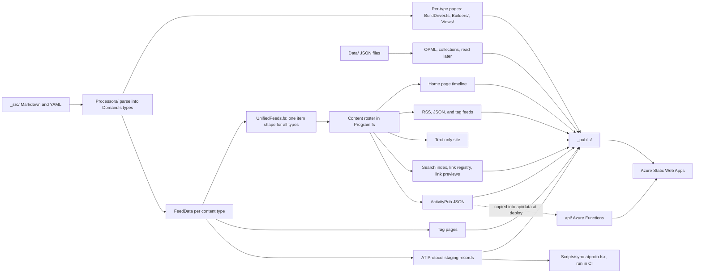

# Architecture

How a Markdown file becomes pages, feeds, and federated posts.

## The short version

In a gist, it's a static website built with .NET and hosted on Azure
([colophon](https://www.lqdev.me/colophon/)). A console program written in F# reads Markdown and
YAML from `_src/` and writes the whole site to `_public/`: HTML pages, RSS and JSON feeds, a search
index, a text-only copy of the site, and the JSON that ActivityPub clients read. Azure Static Web
Apps serves those files. A few Azure Functions in `api/` handle the parts of ActivityPub that need a
server, such as the inbox and WebFinger. Everything else is decided at build time.

## How a post becomes a page

Each content type has a processor in `Processors/` that parses its Markdown files into the types in
`Domain.fs`. The build for that type writes its individual pages and its index page right away,
through `BuildDriver.fs` and the views in `Views/`, and returns a list of FeedData: the parsed item
plus its rendered HTML and RSS entry. `UnifiedFeeds.fs` turns each type's FeedData into one shared
item shape, so the rest of the build doesn't need to know which type an item came from. The content
roster in `Program.fs` has one row per type with three flags (on the timeline, in the all-content
feed, in the blog archive), and the home page, the feeds, the text-only site, the search index, and
the ActivityPub outbox all read from it. Tag pages and the AT Protocol staging records read the
per-type FeedData directly instead. Some pages don't come from `_src/` at all: the OPML blogroll,
the collections, and the read-later page are built from JSON files in `Data/`. Livestreams come from
`_src/streams/` through `Loaders.fs` and skip the roster. Once `_public/` is written, the deploy
workflow copies the ActivityPub JSON into `api/` and publishes both.

## Code map

F# compiles files in the order `PersonalSite.fsproj` lists them, and a file can only use what comes
before it. This table follows that order.

| Group | Files | What it's for |
| --- | --- | --- |
| Types and constants | `Domain.fs`, `Constants.fs`, `StructuredData.fs`, `ReviewSchema.fs`, `ContentTypes.fs` | The shapes of every content type, site constants, and the content-type names |
| Markdown | `CustomBlocks.fs`, `ASTParsing.fs`, `BlockRenderers.fs`, `MediaTypes.fs`, `Diagnostics.fs`, `Services/Markdown.fs` | Markdig setup, the custom `:::` blocks, frontmatter parsing, and content error reporting |
| Services | the rest of `Services/` | Tags, reading time, OPML, Webmentions, related content, QR codes, follower sync |
| Processor core | `GenericBuilder.fs`, `Services/FeedSemantics.fs` | The processor interface every content type implements, and shared RSS rules |
| One processor per content type | `Processors/` | Parse, render, and build the RSS item for one type |
| Across content types | `UnifiedFeeds.fs`, `ContentRegistry.fs` | The shared item shape, the feeds built from it, and the roster filters |
| Federation | `ActivityPubBuilder.fs`, `AtProtoResponseMapping.fs`, `AtProtoBuilder.fs` | ActivityPub JSON and AT Protocol staging records |
| Knowledge graph | `EntityExtraction.fs`, `KnowledgeGraph.fs`, `RdfSerializer.fs` | Links between AI Memex entries, and the graph exports |
| HTML | `Views/` | Giraffe ViewEngine views for every page, including the text-only site |
| Site-wide outputs | `BuildDriver.fs`, `Collections.fs`, `DirectoryIndex.fs`, `SearchIndex.fs`, `Services/LinkRegistry.fs`, `Services/LinkPreview.fs`, `Loaders.fs`, `TextOnlyBuilder.fs` | The generic page driver, collections, search, link checking, link previews, and the text-only site |
| Page builders | `Builders/` | One file per kind of page: content types, tags, the home page, static pages, and so on |
| Entry point | `Program.fs` | Runs everything above in order and sets the exit code |

## What runs when

| When | What runs | Where it's defined |
| --- | --- | --- |
| Build time | The generator: parse `_src/`, write `_public/`, report content errors | `Program.fs` |
| Deploy time, on every push to main | Build with `--strict`, run the RSS and social discovery tests, find Webmentions to send, copy the ActivityPub outbox, followers, and featured JSON into `api/data`, check the site size, deploy `_public/` and `api/` to Azure Static Web Apps. Then, as separate jobs: send Webmentions, queue the two newest ActivityPub posts for delivery, and sync staged AT Protocol records with `Scripts/sync-atproto.fsx` | `.github/workflows/publish-azure-static-web-apps.yml` |
| Request time | 10 HTTP-triggered Azure Functions: the actor, inbox, outbox, followers, following, featured, activities, WebFinger, the delivery trigger, and a health check | `api/` |

Two more workflows run every 5 minutes and deliver queued ActivityPub activities and follow
accepts: `.github/workflows/process-activitypub-deliveries.yml` and
`.github/workflows/deliver-activitypub-accepts.yml`. Pull requests run
`.github/workflows/validate-site-upgrade.yml`, which builds the site and runs the test scripts listed
in the [build reference](reference/build.md).

## Rules the code relies on

The compile order in `PersonalSite.fsproj` matters. If you add a file, put it after everything it
uses and before everything that uses it.

`ContentTypes.fs` is the one place content-type identity lives. Its strings are written into feed
and tag keys, the timeline JSON, and URL routing, and the comment at the top of the file says they
must stay byte-for-byte what those outputs already contain. The types themselves are a closed
union, so adding one makes the compiler point at every place that has to handle it. Feed membership
works the same way: the roster in `Program.fs` replaced hand-kept feed lists after a type was added
to one list and forgotten in another ([ADR 0007](adr/0007-content-type-roster-registry.md)).

HTML comes from Giraffe ViewEngine in `Views/`, not from formatted strings, so a missing closing tag
is a compile error instead of a broken page.

`_public/` is generated. Don't edit it; change `_src/` or the code and build again.

Anything that needs a server lives in `api/`. The generator never talks to the network to publish;
federation that needs a request at publish time runs in the deploy workflow.

By default a bad content file is reported and left out, and the rest of the site still builds. With
`--strict` the same error fails the build, which is how CI runs it. See the
[build reference](reference/build.md).

## Why it is this way

| Question | Decision record |
| --- | --- |
| Why does every content type go through the same processor interface? | [0001](adr/0001-unified-content-processing.md) |
| Why microformats2 in the HTML? | [0002](adr/0002-indieweb-microformats.md) |
| Why a static site and not a server? | [0003](adr/0003-static-site-architecture.md) |
| Why does the home page load its posts from JSON as you scroll? | [0004](adr/0004-progressive-loading.md) |
| Where do the colors and layout come from? | [0005](adr/0005-desert-theme-design-system.md) |
| Why do most content types share one page builder? | [0006](adr/0006-generic-build-driver.md) |
| Why is feed membership a table of flags? | [0007](adr/0007-content-type-roster-registry.md) |
| Why does the timeline get a structured render product instead of HTML strings? | [0008](adr/0008-structured-render-product.md) |
| How does the site post to Bluesky? (Proposed) | [0009](adr/0009-at-protocol-integration.md) |
| How would WebSub work? (Proposed) | [0010](adr/0010-websub-publisher-and-hub.md) |
| Why are follows stored as blogroll entries? | [0011](adr/0011-follows-as-blogroll-state.md) |

The full list with status is in the [ADR index](adr/README.md). The six principles behind these
decisions are on the [principles page](principles.md).

## Old code you should not extend

`Loaders.fs` holds the loaders from before the processors existed. Only a few are still called:
`Program.fs` uses it for livestreams, the OPML feed list, read-later links, and media albums;
`Program.fs` and the home page both use its pinned-posts loader; and `Builders/ResumePage.fs` uses
its resume loader, which runs on every build. The other loaders in the file aren't called by the
build. New content types get a processor in `Processors/` instead.

`Builders/LegacyFeeds.fs` copies the posts, notes, responses, and all-content feeds to the old
file names (blog.rss, microblog.rss, responses.rss, all.rss). `staticwebapp.config.json` already
redirects those same paths to the current feeds, so new feed aliases belong in the config file, not
here.
